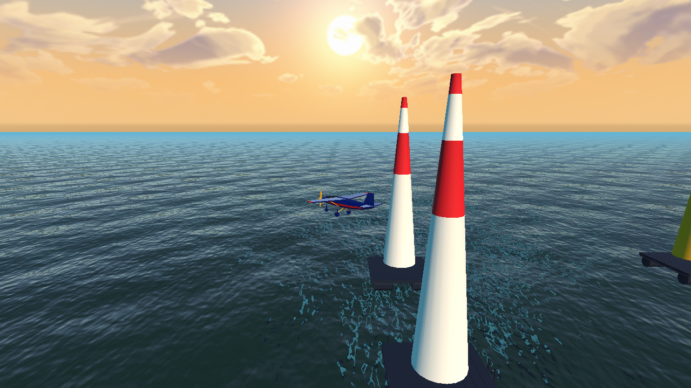

# Análisis y pruebas — Air Race Level 01

## Estado de esta revisión

Revisé los scripts de vuelo, checkpoints, gestión de carrera, el prefab del avión, el prefab de los pilones y la escena `AirRace_Level01_Map`.

La carrera usa un avión de 32 m/s, seis checkpoints a 200–206 m entre centros (unos 6,3 s de vuelo recto entre ellos), un océano de 4,8 km y una barrera invisible a 900 m. Por geometría, la separación de la ruta es razonable para la duración acordada de 60 s. El problema más urgente estaba en la respuesta del choque.

## Diagnóstico del atasco

`OnCollisionEnter` calculaba un rebote, pero `FixedUpdate` reescribía la velocidad del avión hacia delante en el siguiente paso de física. Así el avión podía quedar empujando contra el pilón, sin tiempo para separarse. El prefab del pilón también usa colliders de malla en varias bandas, lo que puede producir contactos menos suaves que un solo collider primitivo.

La respuesta ahora conserva el impulso de salida durante 0,28 s, vuelve gradualmente al vuelo normal durante 0,22 s, usa una superficie de contacto de fricción mínima en los colliders llamados `Pylon_*`, limita el daño repetido y muestra `IMPACT · REBOUND` durante 1,1 s. La lata se hizo 20 % mayor y el anillo pasó de 10,4 m a 13 m de diámetro exterior para leerse mejor sobre el mar.

## Pruebas ejecutadas en Unity 6.3

Ejecuté la escena en una copia aislada del proyecto para no cambiar la escena abierta en el editor. La simulación de física midió:

| Prueba | Resultado |
| --- | ---: |
| Avance recto durante 1 s | 32,00 m |
| Giro a la derecha durante 0,5 s | 17,00° |
| Ascenso durante 0,5 s | 2,30 m |
| Raycast hacia el collider de `Pylon_01_Left` | Detectado |
| Respuesta de separación después de aplicar el impacto | 3,86 m a los 0,08 s |
| Separación tras 1,3 s y vuelta a crucero | 23,58 m; 32,00 m/s |

La prueba automatizada ejecutó la misma rutina de recuperación llamada por el callback de colisión, usando la normal de impacto esperada. El raycast alcanzó el collider real del prefab. La consulta de solape en esta escena aislada no registró intersección y Unity en modo batch no ejecuta el callback de colisión del `MonoBehaviour` como Play Mode interactivo; por eso no doy por verificado el callback real de extremo a extremo. La ruta de recuperación sí quedó medida, pero hace falta confirmar un choque conducido en Play Mode gráfico cuando vuelva a estar disponible el editor.

Resultados numéricos: [unity-mobility-collision-results.txt](unity-mobility-collision-results.txt).

## Cinco mejoras aplicadas

1. Mantener el impulso de separación del avión antes de restablecer velocidad de crucero.
2. Aplicar fricción mínima a los colliders de las piezas del pilón para reducir el enganche en las uniones de malla.
3. Poner un enfriamiento de 0,65 s al daño por impacto para que un mismo roce no descuente energía varias veces.
4. Dar señal visible de impacto y rebote durante 1,1 s.
5. Aumentar la legibilidad de la lata y su aro de energía para distinguirlos mejor a distancia.

## Siete recomendaciones siguientes

1. **Revisar la cámara de persecución:** en la captura el avión ocupa poco espacio y los pilones cercanos pueden dominar el encuadre. Probar una cámara algo más próxima, desplazada lateralmente y con seguimiento amortiguado en los giros.
2. **Simplificar la colisión de los pilones:** sustituir las bandas de malla por un collider suave para el cono y otro para el flotador, manteniendo intactos los modelos visibles. El material de baja fricción ayuda, pero no elimina la complejidad geométrica.
3. **Probar impactos por partes y velocidad:** nariz, punta de ala y tren de aterrizaje; aproximación lenta y rápida; contacto frontal y lateral. Medir que siempre haya separación y no se repita el daño durante el mismo golpe.
4. **Reemplazar el HUD temporal:** la interfaz actual usa `OnGUI`; llevar cronómetro, energía, puntos y checkpoint a una interfaz diseñada para pantalla grande y legible a distancia.
5. **Ajustar energía con una vuelta completa:** ahora la energía inicial es 72 y pierde 3,5 por segundo fuera del impulso; revisar el margen si el jugador falla un checkpoint o toma una curva amplia.
6. **Mejorar la lectura de la ruta:** distinguir visualmente el checkpoint activo, el siguiente y la meta, y añadir una señal clara cuando el jugador lo atraviesa fuera de orden.
7. **Añadir referencias de escala al horizonte:** el mar y el cielo ya ocultan el borde del tile, pero una costa o siluetas lejanas discretas ayudarían a que el escenario no se sienta vacío sin competir con el recorrido.

## Límite de la verificación

`dotnet build Assembly-CSharp.csproj --no-restore` pasó con 0 errores y 0 advertencias después de restaurar los assets de NuGet del proyecto. La validación de contacto real del avión contra el pilón dentro de Play Mode gráfico queda pendiente; el editor conectado estaba en una ejecución anterior y no pude tomar control de esa ventana tras interrumpirse la sesión de automatización.
